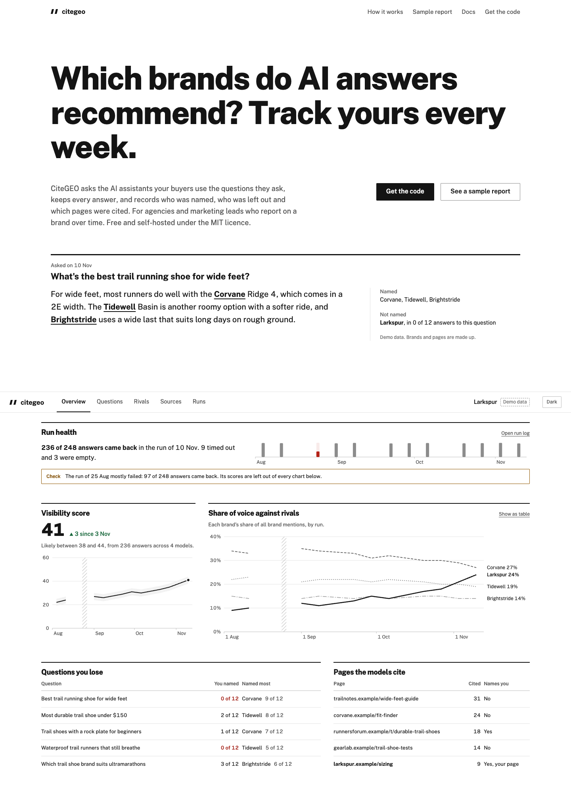
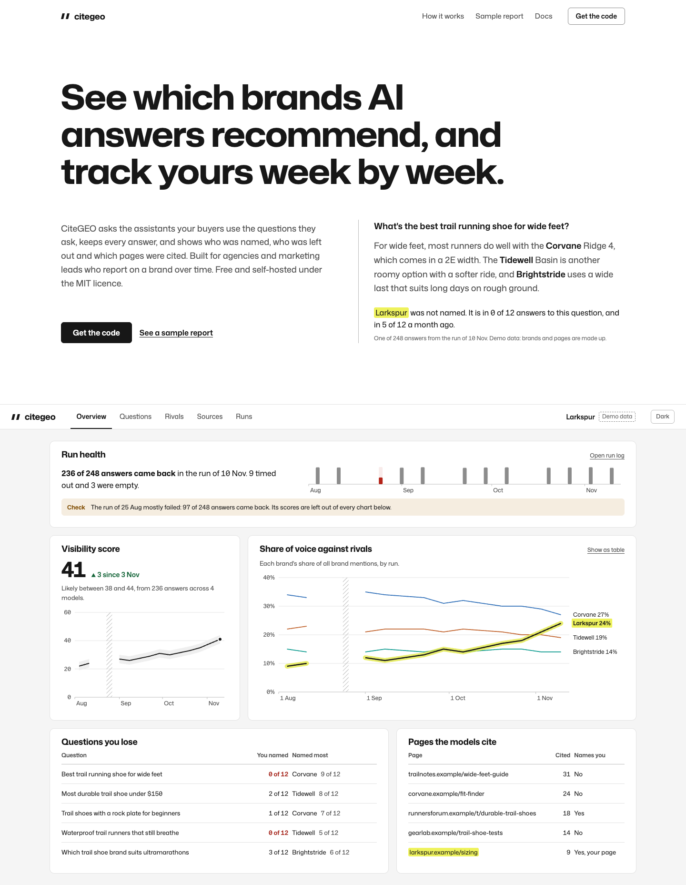
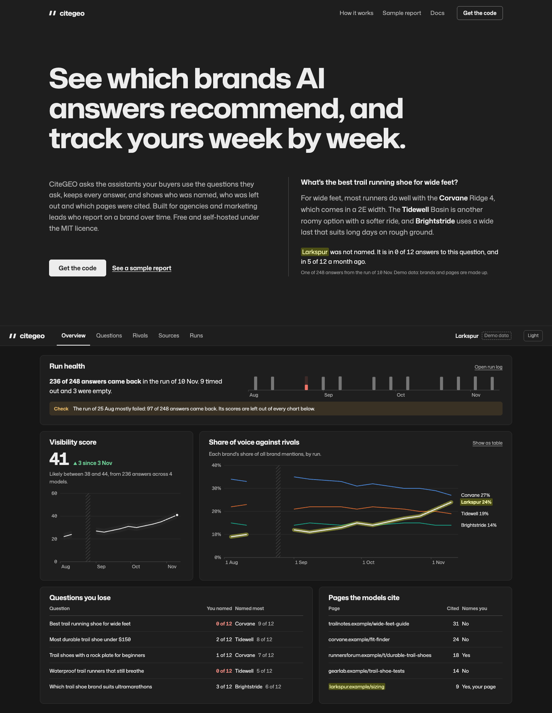
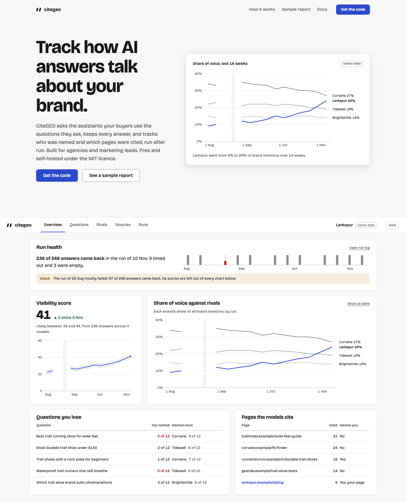

# CiteGEO design system

One system for the app and the marketing site. The values live in code in
[design/tokens.css](design/tokens.css); this file says what they are for. If the
two disagree, the tokens file is wrong and gets fixed in the same commit.

The app's own stylesheet, `src/ui/theme.css`, still ships the older cool grey and
teal values. Moving it onto these tokens is the dashboard work (issues 226 and
227), not this change.

## Overview

**Who it is for.** An agency, or an in-house marketing lead, who tracks how one
brand shows up in AI answers over weeks and months and has to show the result to
a client or a boss.

**What the design has to carry.** Every number has an answer behind it, an
absence is not a zero, and a range is shown when the number is uncertain. The
design makes those visible instead of explaining them in sentences.

**One device.** Your brand is marked with a highlighter wherever it appears: in a
quoted answer on the site, in a table row, on a chart line. Nothing else in the
interface uses that colour, so a reader learns it once.

**Two uses of one system.**

- Site: persuade. Large type set wide, generous space, one real answer as the
  first thing you read.
- App: operate. Same family at normal width, 13 and 14px text, tables over
  cards, one primary reading per page.

**Light first.** The buyer reads this at a desk in daylight and pastes it into
client decks. Dark is a full second set of steps chosen against the dark ground,
not an inversion.

## Colors

**Strategy: restrained.** A zero-chroma grey scale and black ink do almost all
the work. Colour appears only when it means something, and each meaning has one
colour:

| Meaning | Token | Always paired with |
| --- | --- | --- |
| Your brand | `--mark` (wash), `--mark-line` (chart band) | the brand name |
| Up, better | `--up`, `--up-text`, `--up-wash` | a ▲ or the word |
| Down, worse | `--down`, `--down-text`, `--down-wash` | a ▼ or the word |
| Check this | `--warn`, `--warn-text`, `--warn-wash` | the word "Check" |
| Failed | `--fail`, `--fail-text`, `--fail-wash` | the word "Failed", hatching in charts |
| No data | `--absent` | a gap, a dash, or "no data" |
| A rival on a chart | `--rival-1` to `--rival-3`, `--rival-other` | the rival's name at the line end |

Down and failed share red on purpose: both mean worse. They never share a cell,
and failed always carries its word.

Interaction has no colour. Primary buttons are ink, links are underlined ink,
focus is a 2px ink outline with a 2px gap.

**Neutrals.** `paper` is the page, `surface` holds panels and tables, `raised`
is hover and the range band behind a line, `sunken` is code and raw answers.
`line` divides rows, `line-strong` sits under table heads, `edge` outlines
controls (inputs, secondary buttons) because those need 3:1 against the page.

**Dark.** Panels get lighter as they come forward (`#161616` page, `#1E1E1E`
panel, `#262626` raised). The mark turns into a dark olive wash with pale
yellow text, because a bright marker on a dark page glares.

### Contrast, measured

WCAG 2 ratios, computed from the tokens file by a script, not estimated.

| Pair | Light | Dark | Needs |
| --- | ---: | ---: | ---: |
| `text` on `surface` | 17.93 | 14.24 | 4.5 |
| `text` on `paper` | 16.44 | 15.46 | 4.5 |
| `muted` on `surface` | 7.81 | 7.95 | 4.5 |
| `weak` on `surface` | 5.33 | 5.50 | 4.5 |
| `weak` on `raised` | 4.63 | 4.99 | 4.5 |
| `mark-ink` on `mark` | 14.93 | 7.59 | 4.5 |
| `up-text` on `surface` | 6.91 | 8.93 | 4.5 |
| `down-text` on `surface` | 7.60 | 7.21 | 4.5 |
| `warn-text` on `warn-wash` | 6.17 | 7.03 | 4.5 |
| `fail-text` on `fail-wash` | 6.55 | 5.86 | 4.5 |
| `edge` on `surface` | 3.36 | 3.67 | 3 |
| `rival-1` on `surface` | 5.14 | 4.82 | 3 |
| `rival-2` on `surface` | 4.21 | 4.77 | 3 |
| `rival-3` on `surface` | 3.48 | 5.57 | 3 |
| `absent` on `surface` | 3.45 | 3.88 | 3 |

The three rival colours pass a colour-blind separation check for every pair
(worst deutan ΔE 12.7 light, 11.8 dark, OKLab ×100), in both modes.

## Typography

**Mona Sans**, one family, SIL Open Font License 1.1, served by Google Fonts
(`family=Mona+Sans:wdth,wght@75..125,200..900`). It has a width axis from 75 to
125 and true tabular figures (`tnum`), checked in the font file.

The width axis is how one face covers two jobs. The site sets headlines at
`font-stretch: 112.5%` so they read big without going past 72px. The app stays
at 100%. Figures in tables and charts use `font-variant-numeric: tabular-nums`,
so there is no monospace face for numbers. Raw model output, hashes and IDs may
use the system monospace stack; that is the only place mono appears.

| Use | Size | Weight | Notes |
| --- | --- | --- | --- |
| Site headline | clamp(40px, 5.6vw, 72px) | 680 | 112.5% wide, 1.08 leading, max 20ch |
| Site section head | clamp(30px, 3.2vw, 40px) | 680 | 112.5% wide |
| Site subhead | 24px | 600 | |
| Site body | 18px | 420 | 1.6 leading, max 60ch |
| App hero figure | 44px | 680 | tabular |
| App page title | 28px | 680 | |
| App section | 22px | 680 | |
| Panel title | 18px | 680 | |
| App body | 14px | 420 | |
| Table | 13px | 420 | tabular |
| Small | 12px | 420 | the floor: nothing on screen is smaller |

Headings and body differ by at least 1.25x and usually by weight too. Sentence
case everywhere. No all-caps, no letter-spaced labels, no italic for emphasis.

## Layout

- **Site:** 1280px max, gutter `clamp(16px, 4vw, 48px)`. Sections are separated
  by 96 to 128px. Text is left aligned. Each section has one job and one
  heading; no label above the heading.
- **App:** 12-column grid inside 1280px, 16px gaps. One top bar with the page
  links (every page has its own URL). A page opens with its primary reading,
  then the table that explains it. Panels sit on `paper`; tables sit directly
  in panels, never in a card inside a card.
- **Overview order, fixed:** run health (full width), score and change (4
  columns) beside share of voice (8), questions you lose (7) beside pages cited
  (5). Under 900px everything is one column in the same order.
- **Phones:** tables become two-line rows (the question, then "You named 0 of
  12" and the winner). No sideways scroll except the page links in the top bar.
- **Explainers:** no grey sentence under every heading. Method text goes behind
  a "How this is measured" link.

## Elevation and depth

Flat. Panels are a 1px `line` border on `paper`. The only shadow is
`--shadow-float`, for things that float over content: a tooltip, a menu, the
evidence drawer when open. A closed drawer casts nothing.

## Shapes

`--radius-1` 3px for marks and small tags, `--radius-2` 6px for buttons, inputs
and callouts, `--radius-3` 10px for panels and site media. Nothing is pill
shaped.

## Components

- **Number states.** A figure is one of: measured (ink), a range (figure plus
  "likely between 38 and 44"), not measurable (an em-width dash and the reason),
  failed (`fail-text` and the word), loading (a `raised` block the size of the
  figure, no text). Loading never shows a zero, "none" or "not measurable".
- **Delta.** `▲ 3 since 3 Nov` in `up-text`, `▼` in `down-text`. Always says
  what it compares against. The delta and the big figure come from the same
  read.
- **Your brand.** Wrapped in `--mark` with `--mark-ink` text and 3px corners.
  Used on the brand name and on your own pages, never on a whole row.
- **Callout.** `warn-wash` background, the word "Check" in `warn-text`, one
  sentence. It appears once, on the page where you can act on it, not repeated
  across pages.
- **Run health.** First on the overview. If more than 40% of a run failed, its
  scores are left out of every chart and the panel says so.
- **Buttons.** Primary: ink fill, surface text. Secondary: surface fill, `edge`
  border. 44px tall on the site, 32px in the app, 36px on phones in the app.
  Hover changes the fill only. Focus is the ink outline. Disabled is `weak` text
  on `raised` with no border.
- **Tables.** 13px, tabular figures, numbers right aligned, heads in `muted`
  sentence case over a `line-strong` rule, rows split by `line`. A status is a
  word in its colour, not a pill.
- **Tabs and page links.** Text with a 2px ink underline on the current one.
- **Empty.** Says what is missing and the one action that fills it. A panel
  with nothing to show is hidden until it has data.

## Charts

- **Time is time.** The x axis is a date scale. Runs sit at their real dates,
  so a two-week gap looks like one. Month ticks label the axis.
- **Name every line at its end,** with its latest value ("Corvane 27%"), nudged
  apart so labels never overlap. Hovering shows every value for that run.
- **Your line** is ink, 2.5px, over a 10px `--mark-line` band. Rivals are
  1.75px in `--rival-1` to `--rival-3`, in that fixed order by the rival's
  identity, never by rank. A fourth rival and beyond fold into `--rival-other`
  or the table. A chart that compares models uses the same three slots, keyed
  by model ID.
- **Absence is a gap.** A run with no data breaks the line. A failed run gets a
  hatched band across the plot, never a zero.
- **Axes.** Percentages start at 0. Labels are 12px and stay 12px on a phone:
  charts are drawn at the container's pixel width, not scaled from a fixed
  viewBox. Gridlines are `line`, the baseline `line-strong`.
- **Uncertainty.** The score line carries its likely range as a `raised` band.
- **Every chart has a table view** ("Show as table") with the same numbers.
- Never two y axes. Never a colour from the states table on a series.

## Motion

- **Approach:** functional only. Motion answers an action or shows that data
  changed.
- **Durations:** `--dur-press` 80ms, `--dur-quick` 140ms (hover, focus),
  `--dur-panel` 200ms (drawer, disclosure), `--dur-chart` 300ms (a chart
  update). [MOTION_DESIGN_SYSTEM.md](docs/MOTION_DESIGN_SYSTEM.md) has the full
  state model.
- **Easing:** `--ease-out` for entering and for feedback, `--ease-move` for
  something that moves place.
- **The one site moment:** in the hero, the mark sweeps under your brand name
  once when the answer comes into view. Nothing else on the site animates on
  scroll.
- Reduced motion sets every duration to 0.

## Never do

- All-caps or letter-spaced micro labels, or a label above a heading.
- Meta strings joined with middle dots. Write a sentence or use a table.
- A pill or badge repeated on every row.
- Glass, blur, grain, glow, gradient text or gradient fills.
- A coloured border on one side of a card.
- `--mark` on anything that is not your brand. State colours on chrome.
- A loading state that looks like a result.
- A number without a receipt: every figure links to the answers behind it.
- Made-up numbers on the site. Real runs with dates, or demo data labelled as
  demo.
- A hex value, font name or radius written in a surface instead of a token.

## Using the tokens

[design/tokens.css](design/tokens.css) is plain CSS custom properties with light
values on `:root`, dark values under `prefers-color-scheme: dark` (unless
`data-theme="light"`) and under `data-theme="dark"`.

- **Site:** import the file before the site's own CSS.
- **App:** the Tailwind `@theme` block in `src/ui/theme.css` points its
  `--color-*`, `--font-*`, `--text-*`, `--spacing-*` and `--radius-*` entries at
  these properties when the screens move over.

Old app names map like this when that happens:

| `theme.css` today | New token |
| --- | --- |
| `--paper`, `--surface`, `--raised`, `--sunken`, `--line`, `--line-strong`, `--text`, `--muted`, `--weak` | same names |
| `--accent`, `--accent-hover`, `--accent-wash` | none: actions are ink; your brand is `--mark` |
| `--confirmed*` | `--up*` |
| `--unknown*` | `--warn*` |
| `--failed*` | `--fail*` |
| `--font-display`, `--font-ui` | `--font` |
| `--font-mono` | system monospace, raw output only |
| `--type-micro` (10px), `--type-xs` (11px) | `--type-sm` (12px) |
| `--radius`, `--radius-sm`, `--radius-xs`, `--radius-pill` | `--radius-3`, `--radius-2`, `--radius-1`, none |

## Directions we looked at

Three directions, each showing the same site hero and app overview with the same
demo data (a made-up trail shoe brand and three made-up rivals).

**A. Ledger.** No hue outside the states; your brand is the black line and
rivals are greys told apart by dash pattern. Public Sans, ruled panels, square
corners. It drifts toward the hairline broadsheet look, and grey dashed lines are
slow to follow once they cross.

**B. Marker (this file).** Neutral ground, ink, and a highlighter on your brand.
Mona Sans, white panels with 10px corners.

**C. Cobalt.** One owned blue for your brand and for buttons, softer panels with
a light shadow, Bricolage Grotesque. The closest to a stock product site, and
the blue does two jobs.

Phone widths: [A](docs/design/direction-a-390.png),
[B](docs/design/direction-b-390.png), [C](docs/design/direction-c-390.png).

## Decisions log

| Date | Decision | Why |
| --- | --- | --- |
| 2026-11-14 | One system for app and site: neutral greys, ink, a highlighter for your brand, Mona Sans, light first. Replaces the warm charcoal spec here, the warm paper and terracotta line in CLAUDE.md, and the cool grey and teal the app ships. | The three disagreed. The buyer is an agency or marketing lead tracking a brand over time, and the highlight ties the site's quoted answers to the app's tables and charts. |
| 2026-11-14 | 12px minimum text, chart labels at real pixel size, real time axis, labelled line ends. | Axis labels rendered at 4 to 6px on phones and runs were spaced by index, not date. |
| 2026-11-14 | Run health leads the overview; a mostly failed run is left out of charts. | Most answers in one project had failed and the only sign was a yellow box. |
| 2026-09-19 | A chart never plots an absence as a zero. A run with no answer leaves a gap. | Still holds. |
| 2026-09-19 | The dashboard opens on a number, with a trend beside a ranked table. | Still holds; the five-panel order above refines it. |
| 2026-09-11 | The mark is two angled bars forming a quotation mark. | Still holds. |
